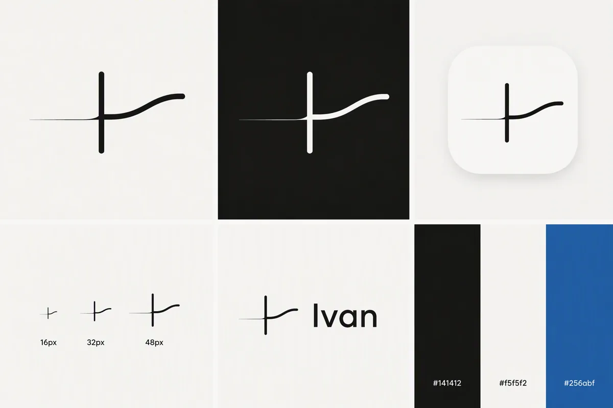

# Ivan 设计系统「墨」

> 研究工具的气质：安静、精确、诚实。界面骨架是墨与纸，颜色只留给数据；
> 品牌的记忆点是一条被竖笔分开的线——回测在前，跟踪在后。

token 的唯一来源是 [`apps/web/src/styles.css`](../apps/web/src/styles.css)，组件在
[`apps/web/src/components/ui.tsx`](../apps/web/src/components/ui.tsx)，图标在
[`components/icons.tsx`](../apps/web/src/components/icons.tsx)，品牌在
[`components/brand.tsx`](../apps/web/src/components/brand.tsx)。这份文档说明「为什么」和「什么时候用哪个」。

**设计判断**：数据产品的改版（保留信息架构，重做视觉），面向自己做研究的 A 股 / 港股投资者，
语言是「研究仪器 + 水墨」：Tailwind v4 的 CSS 变量 token + Geist / Geist Mono + Phosphor 图标 + 克制的动效。
三个刻度：变化度 3（可预期的网格）、动效 4（只做状态变化和进场）、密度 6（日常数据应用）。

## 1. 原则

1. **墨为骨**：界面骨架只用墨与纸两种中性色（同一个略暖的灰族），层级靠字重和深浅，不靠颜色。主按钮是墨色的。
2. **色为数**：颜色只给数据。涨红跌绿（国内习惯），数字始终带正负号，颜色从来不是唯一的识别渠道；
   策略色是一套校验过的分类色；除此之外只有一个强调色。
3. **花青只有一个用途**：AI、链接、焦点、选中。看到花青，就知道这里是 AI 或者「可以点 / 被选中」。
4. **线为界**：发丝线分区；卡片只在层级真的需要时出现；只有浮层才有阴影。
5. **诚实**：界面上的数字都来自引擎；空值写「--」不写 0；AI 写的字和引擎算的数在视觉上分开（AI 头像 + 卡片）。

## 2. 品牌

**标志**：一条被竖笔分开的线。竖笔是 Ivan 的「I」，也是策略上线的那一天；
左边渐细的发丝线是回测（假设），右边上扬的实线是上线后的跟踪（现实）。
这正是产品最核心的那张图：回测段和跟踪段画在同一条曲线上。

| 形态 | 用在哪 | 文件 |
|---|---|---|
| 完整标志 `LogoMark`（宽高比约 1.8:1） | 和字标并排：页头、登录页、分享图 | [`design/ivan-mark.svg`](design/ivan-mark.svg) |
| 紧凑图形 `LogoGlyph`（方形） | 图标、头像、页脚、窄屏页头 | [`design/ivan-glyph.svg`](design/ivan-glyph.svg) |
| 字标 `Wordmark` | 标志 + 「Ivan」（Geist 600，字距 -0.02em） | `brand.tsx` |
| AI 头像 `AiAvatar` | 紧凑图形放在花青底上，只出现在 AI 说话的地方 | `brand.tsx` |
| favicon / App 图标 | 墨底纸色图形；深色浏览器里反过来 | `public/favicon.svg`、`apple-touch-icon.png`、`icon-*.png` |

- 颜色永远跟随 `currentColor`（墨或纸），不给标志单独配色，也不加渐变、阴影、描边。
- 最小尺寸：完整标志高 14px，紧凑图形 16px（favicon 已单独加粗了笔画）。
- 四周留白至少等于竖笔高度的一半。

## 3. 颜色

所有颜色都是语义 token，组件里不写裸色值。浅色是「宣纸」，深色是「墨」——同一套梯度按深色表面重新取阶，
不是自动反色。`data-theme` 手动切换和系统设置都认（账户菜单里：浅色 / 深色 / 跟随系统）。

### 纸与墨

| token | 浅色 | 深色 | 用途 |
|---|---|---|---|
| `page` | `#f5f5f2` | `#0e0e0d` | 页面底色 |
| `surface` | `#fcfcfa` | `#171716` | 卡片、浮层、图表底 |
| `surface-2` | `#f0efeb` | `#1f1f1d` | 悬停、下沉区域、分段控件底 |
| `surface-3` | `#e7e6e1` | `#292927` | 按下、选中较重的底 |
| `ink` | `#161614` | `#ecebe7` | 正文、标题、主按钮底（浅色） |
| `ink-2` | `#4a4944` | `#b8b6ae` | 次要文字 |
| `muted` | `#6b6a64` | `#8e8c85` | 标签、说明（对三种底色都 ≥ 4.5:1） |
| `faint` | `#878580` | `#716f6a` | 只用于图标与装饰（ⓘ、未激活图标、列表圆点），对所有底色 ≥ 3:1；文字不用它 |
| `line` / `line-strong` | 墨 8.5% / 15% | 纸 7.5% / 14% | 发丝线 / 输入框与标签描边 |

没有纯黑 `#000`，也没有纯白 `#fff`。

### 强调色「花青」

| token | 浅色 | 深色 |
|---|---|---|
| `accent` | `#256abf`（对 surface 5.25:1） | `#6da7ec`（7.17:1） |
| `accent-strong` | `#1c5cab` | `#86b6ef` |
| `accent-wash` | 花青 8.5% | 花青 12% |

取自数据色板同一条蓝色梯度（第 500 / 300 阶），所以和图表里的第一条策略线是一家人。

### 数据语义

| token | 浅色 | 深色 | 说明 |
|---|---|---|---|
| `up`（朱） | `#c7362f` | `#ec6a61` | 涨、盈利、买；危险操作也用它（`danger`） |
| `down`（绿） | `#006300` | `#3db463` | 跌、卖；「正常」状态 |
| `neg` | `#2a78d6` | `#3987e5` | 发散图（月度热力、盈亏条）的负向：红绿对色弱不友好，面积编码一律红蓝 |
| `warn`（赭） | `#9c5406` | `#eea531` | 提示、失败、待确认；报错也用它（红在这里是「涨」） |

文字对比度：`up` / `down` / `warn` / `accent` 在三种底色上都 ≥ 4.5:1（计算脚本见落地记录）。

### 图表

策略色 `series-1…6` = dataviz 参考调色板去掉红、绿后的 6 色（D44），按本页的表面色重跑了校验脚本：

- 浅色（surface `#fcfcfa`）：亮度带、彩度下限、相邻对色弱分离（最差 ΔE 9.1）、正常视力下限（19.6）全部通过；
  黄、洋红、青三色对底不到 3:1，按规则用线尾名字和列表补足。
- 深色（surface `#171716`）：全部通过，6 色对底都 ≥ 3:1。

基准线 `bench` 灰色；坐标轴 `axis`、网格 `grid` 退后。颜色跟着策略走，不跟排名走。

## 4. 字体与数字

- **Geist Variable**：拉丁字母与数字；中文回落到系统黑体（苹方 / 雅黑 / 思源）。自托管（`@fontsource-variable`），`font-display: swap`。
- **Geist Mono Variable**：股票代码、日期、版本号、邀请码、图表坐标轴。
- 不用衬线：中文界面没有可靠的系统宋体，AI 的文字靠头像和卡片区分，而不是换字体。

| 用途 | 规格 |
|---|---|
| 页面标题 | 22px / 32px，600 |
| 卡片标题 | 14px / 20px，600，前面可带 16px 图标（muted） |
| 正文 | 14px / 20–24px；简报 14.5px / 28px，最大宽度 72 个字 |
| 标签、说明 | 12px（`text-xs`），`muted` |
| 细注 | 11px（`text-2xs`），只用在页脚、图例、表单提示这类次要位置 |
| 指标大数字 | 26px / 32px，600，字距 -0.02em（`Stat`） |

**数字的排版**（`Figure`）：「+15.4%」里正负号和单位（% 万 亿 倍 天）退后一步——单位缩到 0.62em、透明度 0.72，
让数本身说话。大数字用比例数字；表格列、坐标轴、会上下对比的数用等宽数字（`.tabular`）。

**中文排版**：标题 `text-wrap: balance`，段落 `pretty`，居中短文案 `balance`（避免最后一行只剩一个字）；
中文不加负字距；中英文之间手写空格（「A 股」「跟踪 84 天」）。

## 5. 形状、层级与间距

**圆角只有三档**（加一档弹窗）：

| 圆角 | 用在 |
|---|---|
| 6px（`rounded-md`） | 徽标、标签、小控件、表格里的格子 |
| 8px（`rounded-lg`） | 按钮、输入框、下拉、菜单项、选择片 |
| 12px（`rounded-xl`） | 卡片、浮层、提示框 |
| 16px（`rounded-2xl`） | 弹窗、登录卡片、全屏对话 |

不用胶囊形（`rounded-full`）做容器和按钮；只有圆点、头像里的小图形是圆的。

**层级**：卡片 = `surface` + 发丝线（深色多一道 1px 的顶部高光 `--edge`），没有阴影；
浮层 `shadow-pop`、弹窗 `shadow-modal`，阴影带纸 / 墨的色调；主按钮有一层很薄的 `shadow-raise`。
纸纹：一层 3.5%（深色 5%）的噪点，挂在固定、不接收点击的伪元素上。

**z-index 只有这几档**：对话栏拖柄 20 · 页头 30 · 弹窗 50 · 浮层（菜单 / 提示）60 · 纸纹 80。

**间距**：4px 基准。页面区块之间 24px（`space-y-6`），卡片之间 20px，卡片内边距 16px，表格行高 40px。

## 6. 动效

动效只回答三件事：**状态变了**（浮层出现、分页切换、页面切换）、**在等**（骨架屏、AI 流光）、**按到了**（按下下沉 1px）。

| token | 值 | 用在 |
|---|---|---|
| `animate-enter` | 360ms，上移 6px + 淡入 | 页面切换、分页切换、对话卡片出现 |
| `animate-pop` | 200ms，缩放 0.98 + 淡入 | 菜单、ⓘ、框选条 |
| `animate-modal` / `animate-fade` | 240ms / 200ms | 弹窗与遮罩 |
| `.skeleton` | 1.6s 一道淡光扫过 | 首屏加载（形状贴合最终布局，不用转圈） |
| `.ai-shimmer` | 2.2s 花青流光 | AI 正在做事的状态文字、回测进度 |
| `animate-live` | 2.4s 外扩的环 | 只在「运行中」的跟踪上 |

曲线统一 `cubic-bezier(0.16, 1, 0.3, 1)`；只动 `transform` 和 `opacity`。`prefers-reduced-motion` 下全部静止。

## 7. 图标

只用 **Phosphor** 一个家族、regular 一种字重（导航选中态、警示用 fill），默认 16px。
在 `components/icons.tsx` 里按**概念**起名：同一个概念在任何页面都是同一个图形，换图标只改这一个文件。

| 概念 | 图形 | | 概念 | 图形 |
|---|---|---|---|---|
| 看板 | SquaresFour | | AI（一切 AI 入口） | Sparkle |
| 策略 | Funnel（筛选 + 排序） | | 开始回测 | Play |
| 回测 | Flask | | 上线跟踪 | Broadcast |
| 跟踪 | Pulse | | 停止跟踪 | StopCircle |
| 简报 | Newspaper | | 选股 | ListMagnifyingGlass |
| 净值 / 走势 | ChartLine | | 框选问 AI | Selection |
| 明日计划 | CalendarCheck | | 对话上下文 | Paperclip |
| 持仓 | Briefcase | | 行情服务离线 | Plugs |
| 证据（某个决策日为什么选它） | FileMagnifyingGlass | | | |

「证据」和「选股」是两个概念：选股是一份名单（ListMagnifyingGlass），证据是一只股票在某个决策日的出处清单（FileMagnifyingGlass），不复用。

- 图标帮助扫读，不承载信息：纯装饰的图标自动 `aria-hidden`；只有图标的按钮（`IconButton`）必须给 `label`。
- 不自己画图标路径（品牌标志除外）。

## 8. 组件

| 组件 | 什么时候用 |
|---|---|
| `Button` | `primary`（墨，一屏最多一个）· `secondary`（描边）· `ghost`（工具栏、次要）· `ai`（花青浅底：所有问 AI / 让 AI 做事的入口）· `danger`（停止、删除）。`icon` 传图标，`loading` 时图标换成转圈、宽度不跳 |
| `IconButton` | 只有图标的按钮（关闭、翻页、新对话），必须给 `label` |
| `TextLink` | 「完整报告 ›」这类去别处看的入口（花青）；`onClick` 变体给「恢复默认」这类就地的小操作 |
| `Card` | 标题（可带图标、ⓘ、右侧动作）+ 内容；列表、表格用 `flush` 自己管边距 |
| `PageHeader` | 每个页面的抬头：返回上一级、标题、标签、元信息、动作；窄屏时动作换行 |
| `Tag` vs `Badge` | `Tag` 描边无底色 = 分类元数据（市场、版本号）；`Badge` 有底色 = 状态（运行中、失败、待确认、买卖） |
| `Tabs` vs `Segmented` | `Tabs`（下划线，可带图标和计数）= 换一块内容；`Segmented`（分段）= 同一块内容换个看法（净值 / 超额 / 回撤） |
| `Stat` + `Figure` | 指标卡的大数字；`Figure` 也可以单独用在列表里的大数 |
| `Callout` | `info`（花青）/ `warn`（赭）/ `neutral`，图标 + 文字；`ErrorNote` 是它的报错用法 |
| `Empty` / `ArtCard` | 空状态要说清「为什么空、怎么让它不空」；整块留白的地方配水墨（`art`），小块只用图标 |
| `Skeleton` / `PageSkeleton` / `ListSkeleton` | 首屏加载；按钮里的等待用 `loading` |
| `Modal` | 需要确认或填几个参数的操作（回测、上线、停止、重置密码）；不再用浏览器的 `confirm` / `prompt` |
| `Popover` + `MenuItem` / `MenuLink` | 账户菜单、历史对话 |
| `Info` + `InfoRows` | ⓘ 按需说明（D40）：口径、次要指标、设置 |
| `DataTable` + `Th` / `Td` | 所有表格：表头 muted、数字右对齐等宽、行间一道发丝线、窄屏横向滚动 |
| `Field` + `Input` / `Select` / `Textarea` / `Checkbox` | 标签在上、说明在下、错误在最下；不用占位符当标签 |
| `CopyButton` | 复制后 1.6 秒内显示「已复制」 |
| `SeriesDot` / `LiveDot` | 策略色点（和图里的线同色）/ 运行中的实时点（只用在真实状态上） |
| `Kbd` | 键盘提示 |
| `EvidenceCard` / `EvidenceModal`（`components/evidence-modal.tsx`） | 个股证据（D67）：抬头「名称 代码 · 决策日 X（次日 Y 开盘成交）」，提示用 `Callout`，分组列出估值与价格 / 质量与成长 / 财报 / 数据状态，每行有来源 `Tag`（东方财富、腾讯、中证、深交所、来源未记录）与「数据日」；带策略时多一块名次或没满足的条件与各项分位细条；底部「数据版本 #N · 校验 前 8 位」和「仅供研究，不构成投资建议」，空值写 `--`。对话里是卡片，回测页成交 / 持仓、跟踪页持仓每行一个 `IconButton`「证据」打开同一张 |
| `FanChart`（`components/charts/fan-chart.tsx`） | 未来一年的净值区间（按历史重抽样，D65）：5–95 / 25–75 分位带 + 中位数线，一年内回撤写在图下；按需加载，只在回测页「可信度」分页。文案说「区间」不说「概率」 |

组件的 class 可以被调用方覆盖：`cx` 走 tailwind-merge，冲突的工具类以后写的为准。

## 9. 插画与图片

**方向**：极简水墨，大片留白，一点花青（和强调色同一个颜色）。山脊就是净值线：从淡到浓、一路上扬。

| 文件 | 用在 | 处理 |
|---|---|---|
| `assets/ink/auth-wide.webp` | 登录 / 注册（宽屏，表单落在留白的左半边） | `flatten` |
| `assets/ink/auth-tall.webp` | 登录 / 注册（窄屏） | `flatten` |
| `assets/ink/start.webp` | 首次使用、没有策略 | `alpha` |
| `assets/ink/bamboo.webp` | 还没有上线跟踪（「节节高」） | `alpha` |
| `assets/ink/lost.webp` | 404、页面出错 | `alpha`（阈值 0.03） |
| `public/og.jpg` | 分享卡片（邀请链接发出去时的预览） | 构图时直接排字，文字不交给模型 |

- 图由 create-image（gpt-image-2，low 质量）生成，提示词见附录；后期用 [`scripts/ink-art.py`](../scripts/ink-art.py)：
  `alpha` 去掉纸色只留墨与颜料（透明底，放在任何表面上都没有底框），`flatten` 把背景图的纸纹拉平。
- 深色模式不另外画：`.ink-art` 用 `invert(1) hue-rotate(180deg)` 把墨反成月色，花青的色相保持不变。
- 不用照片、不画 K 线、不画牛熊、不盖红色印章（红在这里是「涨」）。

## 10. 文案与数据写法

- 空值一律「--」（国内行情软件的习惯），不用破折号，也不写 0。
- 百分比始终带正负号；金额自动缩写到万 / 亿；日期 `YYYY-MM-DD` 等宽。
- 一行元信息里最多一个「·」；更多的信息拆成两行或用逗号。
- 界面文案不用破折号「——」。说「策略信号」，不说「推荐买入」。
- 状态从不只靠颜色：徽标有字，诚实检查有图标 + 标题，涨跌有符号。

## 11. 图表

- 字：标签走 Geist，坐标轴数字走 Geist Mono 10.5px；提示框和浮层同一种质感（`tooltipStyle` / `tipHead` / `tipRow`）。
- 线 2px，基准 1.5px；回测段淡、跟踪段实；上线日一条竖线，标签横写在顶端。
- 面积只用在有真实零基线的视图（回撤）；净值轴不从 0 起，不填色。
  例外只有一个：分位区间带：两条分位线之间低透明度填充，不从 0 起，只用于按历史重抽样的区间
  （`FanChart`，透明度不超过 0.12，颜色取策略色 token；中位数仍是 2px 实线）。
- 图上可以拖动框选一段问 AI：右上角常驻一句提示，选中后显示区间 + 「问 AI 这段」。

## 12. 无障碍与性能

- 焦点：全站 2px 花青焦点环；输入框是花青边 + 3px 浅晕。「跳到正文」链接在 Tab 第一下出现。
- 对比度：正文 ≥ 4.5:1，大字 ≥ 3:1；深浅两套都算过。
- 弹窗打开时焦点进入、关闭后回到原处，Esc 关闭；浮层点外面、滚动、Esc 都会收起。
- 每个页面有自己的标签页标题（`usePageTitle`）。
- 每个页面单独一个包，ECharts 跟着第一个有图的页面按需加载：登录页首屏 JS 从 375 KB 降到约 162 KB（gzip）；
  图标家族 tree-shake 到只剩用到的几十个。

## 附录：生成提示词（create-image，gpt-image-2，low）

**标志推演**（1536×1024）
> Premium minimal brand identity concept board for a product named "Ivan": a calm, honest research tool that backtests stock-picking strategies and then tracks them live every trading day (Chinese A-shares and Hong Kong stocks). Logo idea: an extremely simple monogram. One upright vertical stroke (reads as the capital letter I, and marks the moment a strategy goes live) crossed by one continuous line. Left of the stroke the line is thin and faint (the backtest); right of the stroke the same line becomes bold and solid and rises gently (live tracking). Geometric, consistent round-cap strokes, legible at 16px. Layout: clean 2x3 grid … Style: Swiss minimalism with Chinese ink-painting restraint … The only text allowed anywhere is "Ivan".

**登录页（宽）/ 分享卡片底图**（1536×1024）
> Minimalist Chinese ink-wash painting (shui-mo) on flat, clean off-white rice paper, background color #f5f5f2, wide landscape composition. On the right half, a distant mountain range whose ridgeline reads like a smooth stock equity curve drawn with one brush line: toward the left the ridge is faint, thin and misty in pale grey wash; toward the right it continues in rich deep black ink and rises gently. Soft mist bands at the base, one small restrained wash of muted indigo-blue pigment in the farthest peaks. The entire left half is empty paper (negative space reserved for a title). Serene, scholarly, precise. No text, no calligraphy, no red seal stamp, no signature, no people, no boats, no sun or moon, no frame, no border, no vignette.

**登录页（窄）**（1024×1536）：同上，竖构图，山在下三分之一，上面三分之二留白。

**空状态插画**（1024×1024，共用一段风格描述，换主体）
> Minimal Chinese ink-brush illustration, centered small subject with lots of empty space around it: 〈主体〉. Drawn with a few expressive strokes of black ink and soft grey washes, plus one tiny accent of muted indigo-blue pigment. Flat, clean, even off-white paper background #f5f5f2 edge to edge, no paper blotches. Calm, refined, modern. No text, no calligraphy characters, no red seal stamp, no frame, no border, no shadow box.

- start：a slim calligraphy brush resting on a small porcelain brush rest beside a blank sheet of paper, on which one faint, gently rising brush line has just been drawn
- bamboo：one slender young bamboo stalk with three visible joints and two or three small leaves, drawn with light, delicate, quick brush strokes（花青在一片叶子上）
- lost：a tiny lone fishing boat on perfectly still water, drifting in soft morning mist, with the faint outline of distant hills barely visible（花青在水里）
