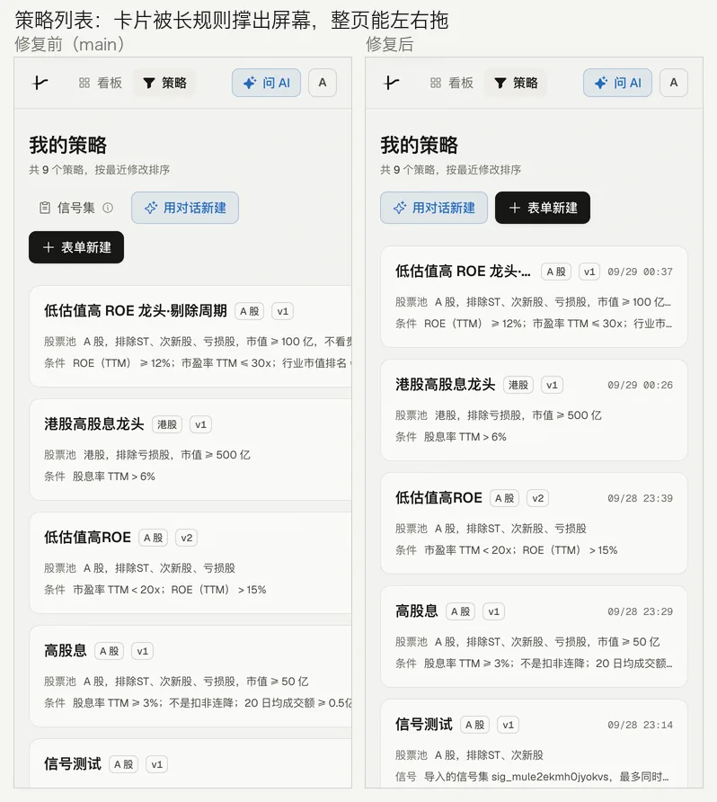
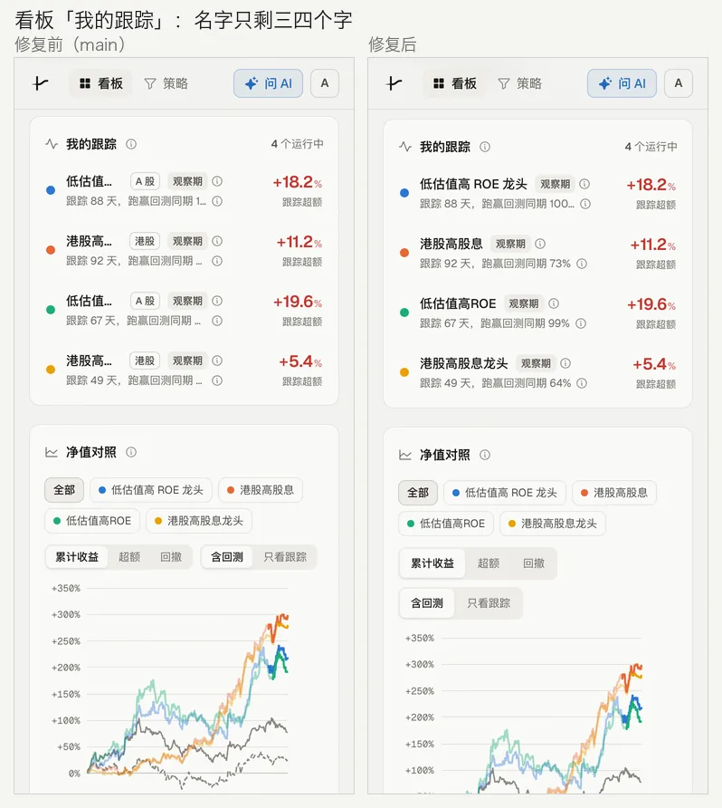
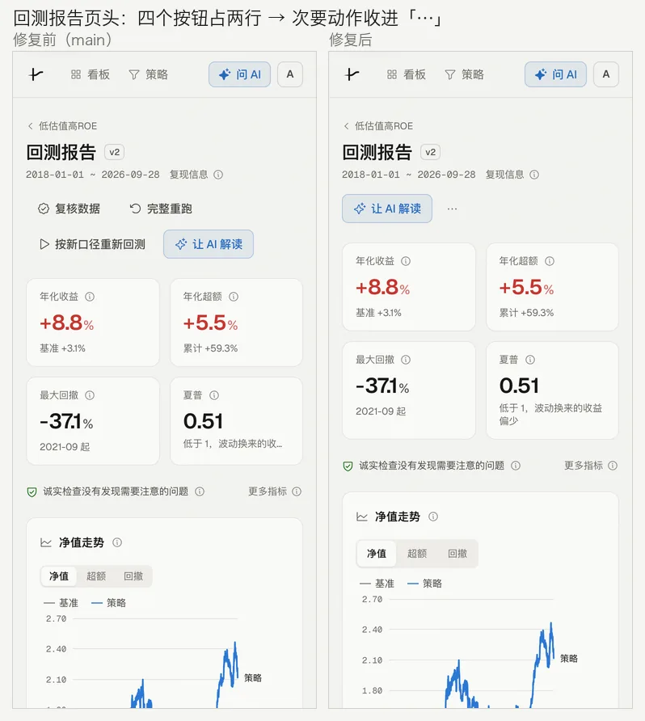
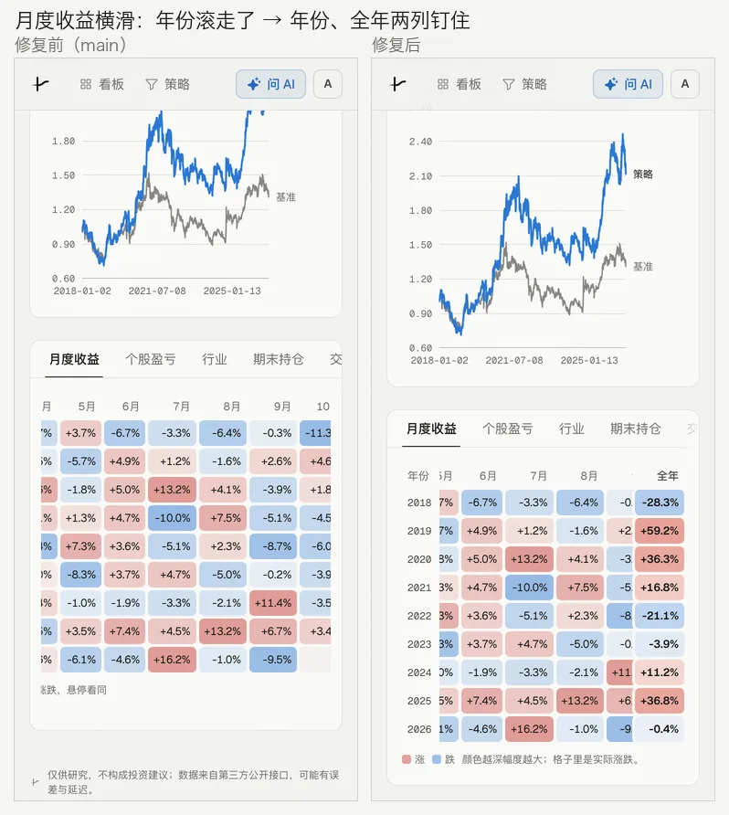
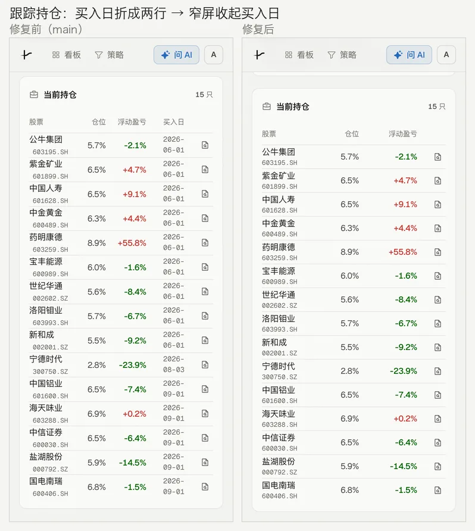
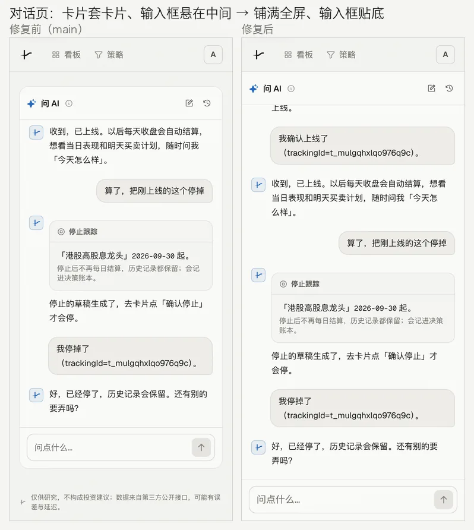
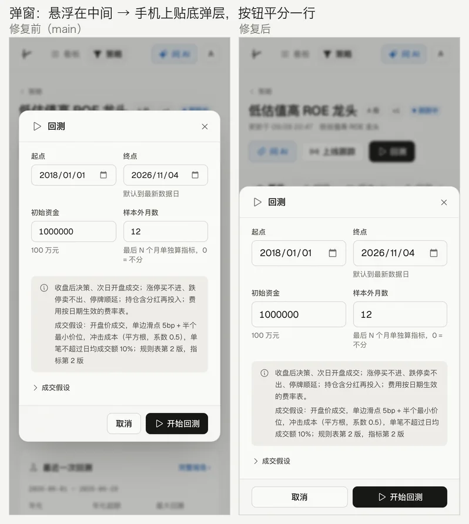
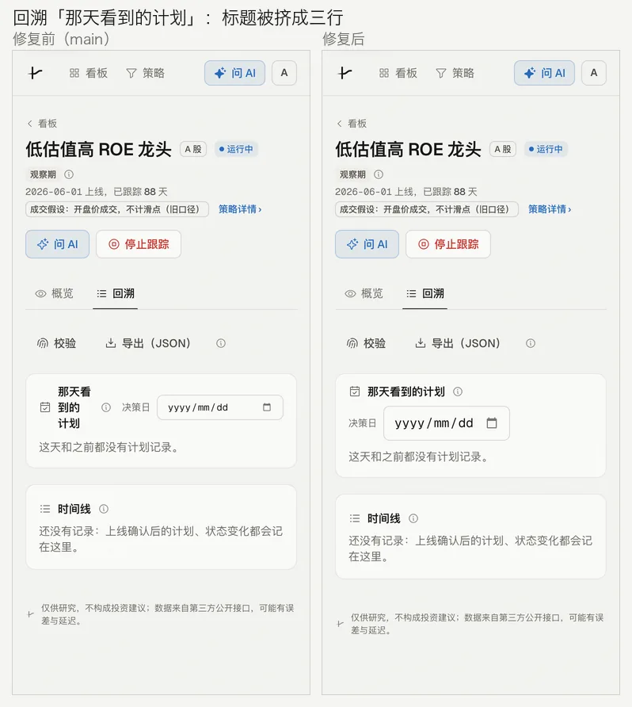
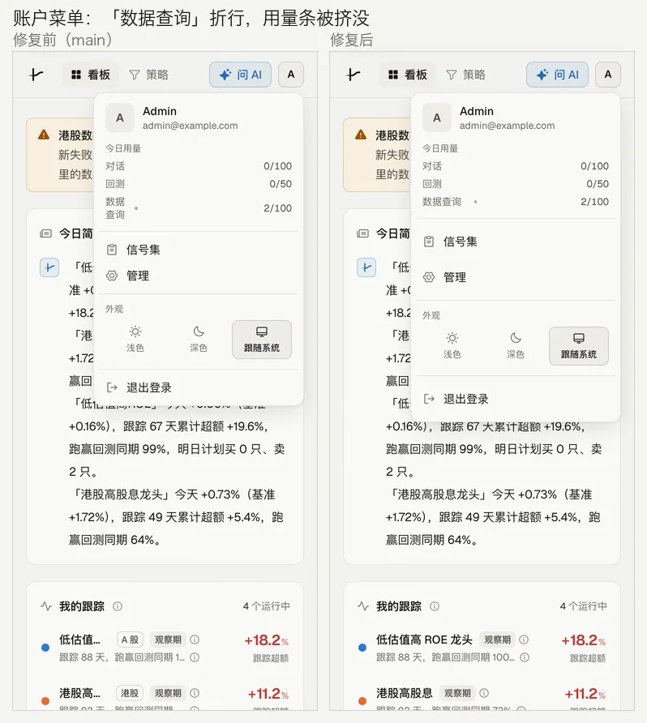

# 手机端体验：整页滚动、触屏点击区、贴底弹层与窄屏收起

- 状态：draft
- 创建：2026-11-04
- 相关：D40（ⓘ 按需说明）、D45（对话栏宽度）、docs/design-system.md §8、§11、§12「手机与触屏」

## 背景

用手机尺寸（375×812，另看 390、430 宽；触屏、深浅两套）把主要页面走了一遍：登录、看板（含数据横幅）、策略列表、策略页（概览、编辑、回测弹窗）、
回测报告（各分页）、跟踪页（概览、回溯、个股证据）、信号集、管理页、全屏对话。每页量了整页和主区域的横向溢出，
列出了触屏下小于 32px 的可点元素。找到的问题：

| 页面 | 问题 |
|---|---|
| 策略列表 | 卡片被最长的一行规则撑到 482px 宽，整页能左右拖（网格列默认按内容最小宽度算） |
| 回测报告「交易明细」等表格 | 表头里 `sr-only` 的「证据」是绝对定位，跳出了表格的横滑框，把整页撑到 685px |
| 看板「我的跟踪」 | 名字只剩三四个字（「低估值…」）：市场标签、判词徽标、ⓘ 和右边 96px 的数字挤在一行 |
| 跟踪页「当前持仓」 | 买入日折成两行（「2026-」「06-01」），每行变成两倍高 |
| 回测报告页头 | 复核数据、完整重跑、按新口径重新回测、让 AI 解读四个按钮占两行 |
| 回测报告「月度收益」 | 13 列横滑，滑过去之后看不到是哪一年，全年要滑到最右边才看到；图例跟着表格一起横滑 |
| 跟踪页「回溯」 | 「那天看到的计划」标题被右边的日期框挤成三行 |
| 指标卡 | 注释被截断（「低于 1，波动换来的收…」） |
| 全屏对话 | 卡片套在页面里，输入框悬在中间，下面还有页脚；输入框 14px，iOS 一聚焦就放大整页 |
| 所有弹窗 | 在手机上浮在屏幕中间，按钮挤在右下角 |
| 所有图表 | 框选问 AI 占住了图上的拖动：手指从图上开始往上滑，整页不动（图在手机上占了四成屏） |
| 全站 | ⓘ 16×16、只有图标的按钮 28×28、分段切换 24 高、文字链接 16 高，手指很难点中；输入框 14px（iOS 聚焦放大） |
| 全站 | 主区域自己滚：iOS 地址栏收不起来、点状态栏回不到顶部；开了 `viewport-fit=cover` 却没有让开安全区 |
| 账户菜单 | 「数据查询」标签只有 28px 宽，折成两行，用量条被挤没（桌面也一样） |

## 方案

不另做一套手机布局，在现有组件上按宽度和指针类型逐级收起。宽屏（≥ 1024px）和鼠标下的样子不变（1280 宽逐页截图对比，像素一致）。

**全站**

- 窄屏（< 1024px，没有对话侧栏）整页随文档滚动，页头 `sticky`；宽屏仍是主区域自己滚。主区域横向 `overflow: clip` 兜底。
- 触屏（`pointer: coarse`）点击区：ⓘ、`IconButton`、`Button`、`TextLink`、`CopyButton`、返回链接、分段切换、看板的策略选择片、
  密码显示按钮用一层透明的 `::after` 撑到约 40–44px，不改布局；`Input` / `Select` / 菜单项加高到 44px，复选框整行 40px。
- 触屏输入框 16px（iOS 不放大）；`interactive-widget=resizes-content`（安卓 Chrome 弹键盘时页面变矮）。
- 安全区：页头让开顶部（PWA 独立模式），页脚、弹层、对话输入框、编辑器贴底的保存条让开底部，`#root` 横向让开刘海。
- `Modal` 在 < 640px 是贴底弹层：全宽、上圆角、从底边升上来（240ms），按钮平分一行。
- `Tabs` 放不下时选中项滚进视野，被裁掉的一侧淡出。`Card` 右侧动作放不下时换到标题下面一行。`Stat` 注释最多两行。
- `DataTable` 外壳 `relative`，表头的 `sr-only` 留在横滑框里。
- 新组件 `MoreActions`：页头次要动作宽屏平铺，手机上收进「⋯」。
- 图表（`NavChart`、`MultiNavChart`）在触屏上不开框选；点一下仍出提示框。

**页面**

- 策略列表：卡片 `min-w-0`；手机上页头只放「用对话新建」「表单新建」，「信号集」在账户菜单里。
- 看板「我的跟踪」：容器窄于 448px 时收起市场标签，右边数字列 80px。
- 跟踪页「当前持仓」：容器窄于 448px 时收起买入日（个股证据里有决策日和成交日），代码换到名字下面一行。
- 回测报告：页头次要动作进「⋯」；月度收益年份、全年两列钉住，图例不跟着横滑；交易明细日期不折行。
- 全屏对话：手机上铺满页头以下，不要卡片边框和页脚。
- 管理页：LLM 用量的日期不折行。账户菜单：用量标签 56px。

## 决策记录

- **D112 手机上逐级收起，不另做一套；触屏的点击区撑开而不是把控件画大（2026-11-04）。**
  窄屏（< 1024px）整页随文档滚动，换来 iOS 地址栏收起、点状态栏回顶部；宽屏有常驻对话栏，主区域仍自己滚。
  触屏判断用 `pointer: coarse`、不看宽度（iPad 也按手指算）；ⓘ、图标按钮这类小控件用透明伪元素把可点范围撑到 40–44px，
  画出来的大小和桌面一样，桌面密度一点不变。窄的时候先收起次要信息（市场标签、买入日、次要按钮），信息在 ⓘ、详情或「⋯」里还找得到，
  实在放不下的（月度收益 13 列、交易明细 9 列）才横滑，横滑时钉住看懂一行要的列。手机上弹窗贴底。
  触屏不开图表框选：框选和整页滚动抢同一个手势，手机上「问 AI」走对话页（手机上框选提示本来就藏着）。
  放弃的方案：手机单独一套布局或底部导航栏（导航只有「看板 · 策略」，页头放得下）；表格在手机上变摘要列表（jim-uiux 的默认，
  这里持仓表收起一列就放得下，交易明细是查账用的，横滑更直接）；控件在触屏上统一画到 44px（页面会明显变松，和「墨」的密度 6 不符）；
  触屏加一个「框选」开关（多一个控件，先看手机上有没有人要）。

## 验收标准

1. 375 / 390 / 430 宽、触屏：所有页面的文档与主区域横向没有溢出（`scrollWidth` = 视口宽）。
2. 触屏下可点元素（含透明点击区）都 ≥ 32px 高，ⓘ ≥ 40、按钮 ≥ 44；例外只有看板跟踪行里的名字链接（整行可点）。
3. 1280 宽、鼠标：各页截图与改动前逐像素一致（对话页消息的滚动位置本来就不稳定，除外）。
4. 手机上回测、停止跟踪、个股证据等弹窗贴底，按钮平分一行；对话页铺满，输入框贴底。
5. 手指从图上开始上下滑，整页跟着滚；点图出提示框。
6. `pnpm lint`、`pnpm typecheck`、`pnpm test`、`pnpm build`、`pnpm format:check` 通过。

## 落地记录

### 2026-11-04 实现（未合并、未部署）

只动前端 `apps/web` 与设计系统文档。走查和截图用的是本机一份行情仓与应用库的副本（单独的端口，调度关闭），
在 Chromium 的手机模拟（触屏、2 倍屏）下截图；修复前是 main（48aee32），修复后是本分支，同一组步骤。

### 还没改的

- 看板数据横幅里「去管理页重跑」的点击区：横幅正在另一个分支（`fix/hk-catchup`，D111）里重写，等它合并后再加，避免冲突。
- 交易明细仍是 9 列横滑；如果手机上常看，可以收成「日期 · 股票 · 买卖 · 金额」两行的摘要。
- 管理页的任务表、用户与额度、LLM 用量表在手机上横滑（管理员用，没收列）。
- 看板跟踪行：名字链接只有 20px 高（点整行是选中对照，点名字才是跳转），手机上可能改成整行跳转、选中挪到圆点上。
- 触屏上的框选问 AI 先关掉了，要的话加一个「框选」开关。
- 编辑分页的长表单在手机上能用，但很长；没做分组折叠。
- 只在 Chromium 的手机模拟下验证过：iOS Safari 的安全区、键盘弹出后的输入框位置、PWA 独立模式顶部，要在真机上再看一遍。
